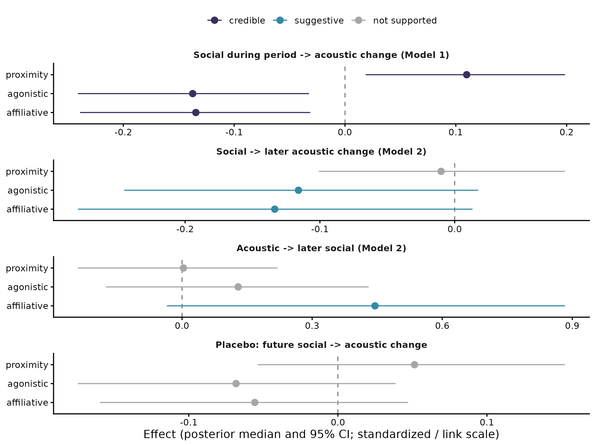

This site contains the statistical analysis of how social interactions and vocal convergence influence each other in budgerigars (*Melopsittacus undulatus*). Twelve groups of four birds (Young and Old treatments) were recorded over five consecutive acoustic blocks, and proximity, affiliative and agonistic interactions were scored from video during the same period. Acoustic similarity between the two birds of each dyad was measured as the energy distance between their call distributions in acoustic space (PCA on MFCC descriptors).

## Analysis report

- **[Statistical analysis](scripts/stats_v06_energy.qmd)**: energy distances with bootstrap measurement error, social data aligned to the acoustic blocks recorded at the same time, a model of acoustic change during each period (Model 1), a joint cross-lagged model of acoustic and social responses (Model 2), and robustness checks (placebo, prior sensitivity)

## Main results

- Dyads with **more affiliative or agonistic interactions** during a period **converged acoustically** over that period, while dyads that spent more time close together diverged slightly, after accounting for the other behaviors. These associations improved out-of-sample prediction over a model without social predictors
- In time-ordered (cross-lagged) models, more affiliative and agonistic interactions in one block were followed by acoustic convergence in the next block (suggestive: probability of direction 0.95 to 0.96)
- Dyads that sounded more different tended to have more affiliative interactions in the following block (suggestive; credible under a wider prior)
- A placebo model using future social behavior found no effects, so the associations are unlikely to reflect stable dyad-level tendencies

::: {.figure-gallery}

:::

## Reproducibility

The analysis code is available in the [GitHub repository](https://github.com/maRce10/vocal-convergence-social-behavior-budgies). Code results are cached in `_freeze/`, so the website can be rebuilt without rerunning the models.
